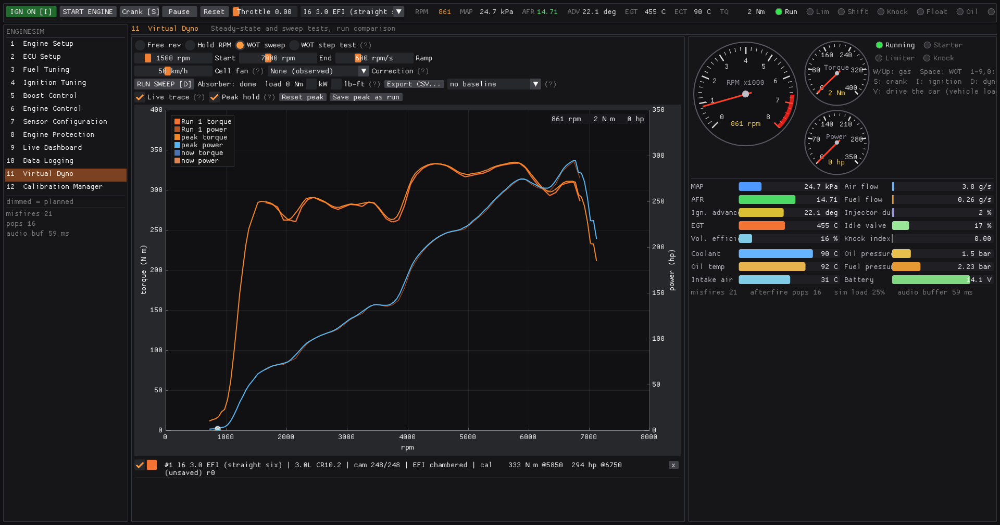
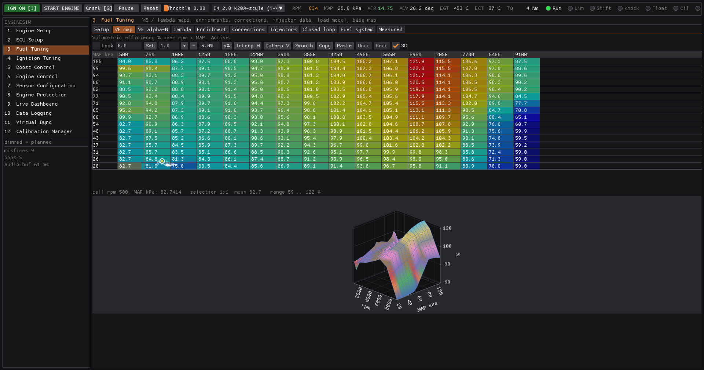
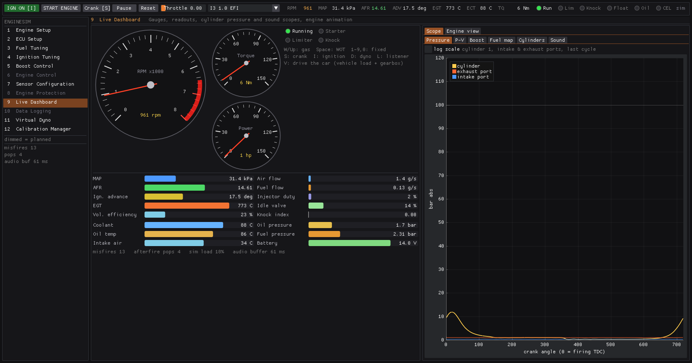
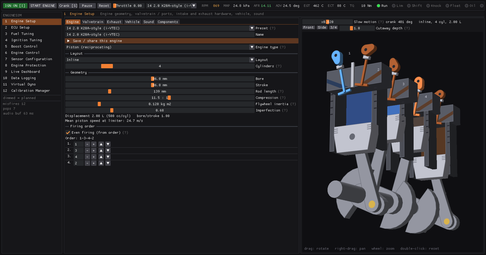
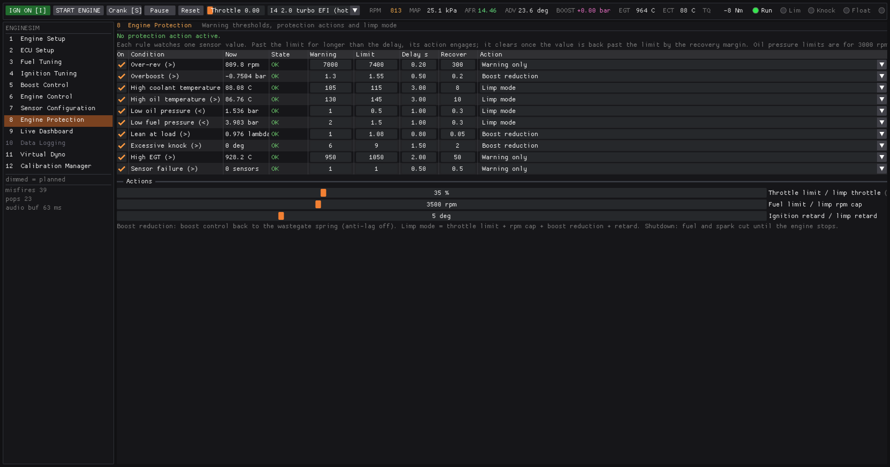

<div align="center">

# EngineSim

**A real-time internal-combustion engine simulator — with sound that comes out of the physics and a full ECU tuning platform.**

[](https://github.com/whyildan/engine-simulator/releases)
[](LICENSE)




</div>

EngineSim simulates every cylinder (or every rotor face) of an engine in real time: gas exchange, combustion,
heat, friction and the pressure waves in the intake and exhaust. The sound you hear is **not sampled** — it is
the exhaust flow of the simulated engine, radiated from the tailpipe. Change the firing order, the header
lengths or the rotary porting and the engine *sounds* different because it *is* different.

On top sits an ECU that only sees virtual sensors and runs on editable calibration maps, like real tuning
software: VE / lambda / ignition tables, closed-loop fuel trims, knock control, boost control, engine
protection, a virtual dyno and a calibration manager. Everything is changed **live, while the engine runs**.

## Highlights

| | |
|---|---|
| 🔊 **Physics-based sound** | Waveguide intake / exhaust network, per-pipe gas temperature, impulse-response convolution, mechanical noise, afterfire pops. |
| ⚙️ **Any layout** | Inline, V, boxer, 1–16 cylinders, odd-fire / big-bang, custom firing orders — and **Wankel rotaries** with 1–4 rotors and four porting styles. |
| 🌀 **The rotary "brap"** | A bridge-ported 13B idles lumpy because exhaust floods back through the port overlap and the diluted charges misfire — modelled, not faked. |
| 🔧 **ECU tuning platform** | Table editor with live operating point and 3D view, speed density / alpha-N / MAF / hybrid load, enrichments, STFT / LTFT, per-cylinder knock control, ECU boost control. |
| 🛡️ **Engine protection** | Ten configurable rules (overboost, oil pressure, coolant, lean, knock, EGT, sensor failure …) with limp mode and shutdown. |
| 🌬️ **Forced induction** | Turbos with lag, wastegate, BOV flutter and anti-lag; Roots, twin-screw and centrifugal superchargers. |
| 📈 **Virtual dyno** | WOT sweeps and steady-state holds, before / after comparison with deltas, metric or imperial units, CSV export. |
| 🏁 **Motorsport** | Launch control (2-step) with pops and bangs, 3-step / flat shift, shift cut, traction control, transbrake, rolling anti-lag, progressive wet / dry nitrous. |
| 🗂️ **Data logging** | 48 channels at 10–100 Hz, markers, stacked graphs over time or rpm, CSV export / import, session compare tied to the calibration version. |
| 🎛️ **Custom dashboard** | Your own grid of gauges, digital readouts and bars with warning / alarm thresholds and a sensor status strip. |
| 🚗 **Drive it** | Car or motorcycle as the load: manual / auto-clutch / automatic gearbox, clutch, tyre slip, 0–100 and 1/4-mile timers. |
| 🧪 **Virtual sensors** | Lag, noise, 10-bit ADC, transport delay, faults (open / short / stuck / noisy) and the ECU's fallbacks. |
| 💾 **Calibration manager** | JSON calibrations per engine, version history, compare, locks, validation. |

| | |
|---|---|
|  |  |
| *Fuel Tuning — VE map with operating point and 3D surface* | *Live Dashboard — gauges, readouts, cylinder pressure scope* |
|  |  |
| *Engine Setup — geometry, firing order, animated engine* | *Engine Protection — rules, live state, actions* |

## Getting started

**Download:** grab `EngineSim-<version>-win64.zip` from the [Releases](https://github.com/whyildan/engine-simulator/releases)
page, unzip it anywhere and run `enginesim.exe` (Windows 10/11 x64, any DirectX 11 GPU). The release page also
has short audio samples.

Then: pick a preset in the header, press **START ENGINE** (or hold `S`), and use `W` / `Space` for throttle.
The first start of each engine measures its base fuel map on a virtual dyno in the background (a few seconds,
cached afterwards in `basemaps/` next to the exe).

```bash
enginesim.exe --preset 23 --section 11   # start with the bridge-port rotary, in the Virtual Dyno section
```

### Controls

| Key | Action |
|---|---|
| `S` (hold) | starter (switches the ignition on) |
| `I` | ignition on / off |
| `W` / `↑` (hold) | throttle (opens gradually) · `Space` (hold) full throttle |
| `1`…`9`, `0` | fixed throttle 10 %…90 %, 100 % · `↓` release |
| `D` | dyno sweep |
| `R` | data log: start / stop recording · `M` marker |
| `C` + full throttle, standing | 2-step launch limiter (when launch control is on) |
| `T` (hold) | transbrake · `G` (hold) rolling anti-lag · `X` nitrous arming switch |
| `L` | listener: tailpipe / engine bay / cabin |
| `V` | driving mode (car as the load) |
| `E` / `Q` | shift up / down · `N` neutral · `C` (hold) clutch · `B` brake |

### Presets

| # | Engine | # | Engine |
|---|---|---|---|
| 0 | I4 2.0 EFI (hatchback) | 12 | Rotary 13B 2-rotor |
| 1 | I3 1.0 EFI | 13 | Rotary 20B 3-rotor (street port) |
| 2 | I6 3.0 EFI | 14 | Rotary 26B 4-rotor (peripheral port race) |
| 3 | V6 3.5 EFI | 15 | Rotary 1-rotor carb |
| 4 | V8 5.7 crossplane carb | 16 | I4 2.0 turbo (hot hatch) |
| 5 | V8 4.5 flatplane EFI | 17 | V8 6.2 Roots blower |
| 6 | V10 5.2 EFI | 18 | Rotary 13B turbo |
| 7 | V12 6.0 EFI | 19 | I6 3.0 big single turbo + anti-lag |
| 8 | Flat-4 2.5 boxer (unequal headers) | 20 | V6 3.5 centrifugal supercharger |
| 9 | V-twin 1.6 45° carb | 21 | I5 2.5 EFI |
| 10 | Single 0.5 thumper carb | 22 | Flat-6 3.6 boxer |
| 11 | I4 1.6 ITB race | 23 | **Rotary 13B bridge port (brap idle)** |

## Building from source

Requirements: Windows, Visual Studio 2019 or newer (MSVC, C++17), CMake ≥ 3.16. Dependencies — Dear ImGui
1.90.9-docking, ImPlot 0.16, ImPlot3D 0.2, miniaudio 0.11.21 — are fetched automatically on the first configure.

```bash
cmake -S . -B build -G "Visual Studio 16 2019" -A x64
```

```bash
cmake --build build --config Release
```

If CMake is not on your PATH, use the one bundled with Visual Studio
(`…/Common7/IDE/CommonExtensions/Microsoft/CMake/CMake/bin/cmake.exe`). The app is `build/Release/enginesim.exe`.

## The application

A fixed header (ignition, START ENGINE, throttle, preset, RPM / MAP / AFR / timing / boost / EGT readouts and
warning lamps) and a 12-section navigation in the style of ECU software:

1. **Engine Setup** — geometry, valvetrain / rotary ports, exhaust, vehicle, sound, components
2. **ECU Setup** — loop rate, cold start, simulation pause / reset
3. **Fuel Tuning** — VE (speed density / alpha-N), lambda, enrichments, corrections, injectors, closed loop, base map
4. **Ignition Tuning** — ignition map, corrections, knock control, per-cylinder trims
5. **Boost Control** — turbo / supercharger hardware, ECU boost control, anti-lag, nitrous
6. **Engine Control** — idle control, drive-by-wire pedal map, soft / hard rev limiter, launch / shift, traction control
7. **Sensor Configuration** — true vs measured values, noise, lag, fault injection
8. **Engine Protection** — protection rules, limp mode, shutdown
9. **Live Dashboard** — gauges, readouts, scopes (pressure, P-V, boost, fuel map, sound) and a configurable
   *Custom* dashboard (layout saved to `dashboard.cfg` next to the exe)
10. **Data Logging** — record channels, markers, graphs vs time / rpm, CSV export / import, session compare
11. **Virtual Dyno** — sweeps, holds, before / after comparison, Nm / kW or lb-ft / hp, CSV export
12. **Calibration Manager** — files, versions, compare, validation

<details>
<summary><b>Everything you can configure (all live)</b></summary>

- **Engine**: piston / rotary; inline / V / boxer; 1–16 cylinders, bank angle, bore, stroke, rod, compression,
  flywheel, **firing order**, even firing or **free per-cylinder phasing** (odd-fire V-twin, big-bang), exhaust
  bank split.
- **Valvetrain**: valves and diameters, cam duration, lift, centerline / LSA, cam advance (VVT), lash, with a
  valve lift / overlap graph.
- **Fuel & intake**: EFI (port / throttle body, injector size and dead time) or a carburettor (barrels, venturi,
  jets, idle screw, accelerator pump, choke); throttle body or ITBs, plenum, runners, air filter.
- **Exhaust**: log manifold / N-into-1 / tri-Y headers, per-cylinder primary lengths ("boxer rumble"),
  collector, true dual / H / X / Y crossover, cat, resonator, muffler type, tailpipe.
- **Sound**: *Smooth* (engine-sim style: exhaust pulse pressure + band limit + air noise + impulse response) or
  *Raw* (pure tailpipe flow radiation); pulse pressure mix, rasp (jet noise), punch, optional wave steepening,
  environment reverb (open road, garage, dyno cell, tunnel), impulse responses (built-in or **your own WAV**),
  listener position (tailpipe / engine bay / cabin), *imperfection* (cylinder-to-cylinder and cycle-to-cycle
  spread).
- **Components** — every part has a physical effect: piston / rod / crank material and mass (inertia, safe rpm),
  ring tension (friction), lifters and springs (**valve float**), throttle type, injectors, coils and plugs
  (misfire, pre-ignition, fouling), oil and water pumps. Optional **mechanical failure** when parts are
  overloaded, the engine knocks hard or valves hit pistons.
- **Separate ECU + virtual sensors**: TPS, pedal, MAP, MAF, IAT, ECT, narrowband O2, wideband, CKP, CMP, knock,
  EGT, oil pressure / temperature, fuel pressure, speed, gear, battery — with lag, noise, ADC, faults and
  out-of-range fallbacks (MAP failure → alpha-N limp, CMP lost → batch fire, CKP lost → engine stops).
- **Thermal, fuel supply, electrics**: coolant / oil / intake temperatures, thermostat, radiator and fan;
  rail pressure from pump + regulator; battery and alternator (injector dead time follows the voltage).
- **ECU calibration**: VE maps (speed density and alpha-N), target lambda, ignition, cranking / warm-up /
  after-start / acceleration / DFCO-exit enrichments, IAT / ECT corrections, injector data, per-cylinder trims,
  load mode SD / alpha-N / MAF / hybrid. The base VE map is **measured on a virtual motoring dyno** for every
  engine (and again when you change its air path); wideband auto-tune refines it.
- **ECU control loops**: STFT + learned LTFT table (learning conditions, limits), per-cylinder knock control via
  a crank-angle knock window, idle target over coolant temperature with PID and idle spark control,
  drive-by-wire pedal map, soft limiter (retard + partial spark cut), ECU boost control (target over rpm ×
  throttle × gear, feed-forward + PID to a wastegate solenoid, overboost cut, boost cut).
- **Motorsport**: launch control (2-step: rpm, timing, spark or fuel cut, enrichment), clutch-in limiter while
  moving (3-step at a fixed rpm, or flat shift holding the clutch-in rpm), shift cut on the gear-change signal,
  traction control (slip target over speed, PI → retard then spark cut), transbrake (automatic / auto-clutch:
  holds the car, the engine loads against it like a converter at stall), anti-lag on lift-off and rolling
  anti-lag on a button, nitrous (shot size, wet or dry kit, bottle, arming switch, rpm / throttle / coolant
  window, delay, progressive ramp, timing retard, lean shut-off).
- **Data logging & dashboard**: pick channels and a rate (10 / 20 / 50 / 100 Hz of simulated time), add markers
  (automatic ones on protection actions, limp mode, gear changes, launch and nitrous), up to 6 stacked graph panels with linked
  zoom / pan over time or rpm, overlay a second session, export the channels you choose to CSV (with engine,
  calibration name and revision in the header) and load CSV logs back. Custom dashboard widgets show any log
  channel as a gauge, digital readout or bar with low / high warning and alarm thresholds.
- **Engine protection**: over-rev, overboost, coolant / oil temperature, oil / fuel pressure, lean at load,
  excessive knock, EGT, sensor failure — each with warning, limit, delay, recovery and an action (warning,
  retard, boost reduction, throttle limit, fuel limit, limp mode, shutdown).
- **Rotaries**: 1–4 rotors, R / e / B, compression, apex seal wear, port timing and area, porting presets
  (stock side port, street port, **bridge port**, peripheral port).
- **Forced induction**: turbo (compressor size, turbine A/R, inertia, wastegate, BOV, anti-lag) or supercharger
  (Roots, twin-screw, centrifugal; size, pulley, bypass), intercooler, live compressor map.
- **Vehicle**: gears and ratios, final drive, clutch, mass, Cd·A, rolling resistance, tyres and grip, gradient.

Pipe length / diameter changes glide smoothly; topology changes (cylinders, engine type, header type …)
rebuild the engine with a short sound crossfade, without stopping it.

</details>

<details>
<summary><b>How it works — the physics</b></summary>

- **Cylinders**: control volumes (mass, energy, fuel and burned-gas fractions), slider-crank kinematics,
  compressible orifice flow through the valves, **Wiebe** combustion whose duration depends on rpm, λ and
  residual gas, cycle-to-cycle variation, misfire (lean, rich, dilution, weak spark, fouled plug), Woschni heat
  transfer, end-gas knock index. The EGT sensor sees the gas after the exhaust port, which loses heat to the
  port wall (Dittus–Boelter convection, pulsating-flow factor) — so a low-flow idle reads well below the
  in-cylinder exit temperature. Fuel that burns in the manifold (overrun pops, a spark-cut 2-step) heats the
  exhaust gas further — that is what spools a turbo on the 2-step.
- **Nitrous**: N₂O is fed to the ports as air-equivalent charge (its extra oxygen plus its decomposition heat),
  with a wet kit's own fuel and charge cooling from the liquid flashing to gas; a 100 hp jet flows ~32 g/s.
- **Intake & exhaust**: a **digital waveguide network** — bidirectional delay lines with frequency-dependent
  losses, N-way scattering junctions, gas composition carried along each pipe, and open ends that radiate. Each
  pipe has its own gas temperature following the EGT, so resonances move with load.
- **Sound**: the tailpipe flow radiates as a monopole; the *Smooth* chain adds the exhaust pulse pressure and
  band-limits it, then an impulse response supplies the muffler / body timbre. Structure-borne noise comes from
  block and head resonance modes excited by combustion, valve seating and pops; the cabin listener hears it
  through a low-pass and cabin booms.
- **Rotary**: three chambers per rotor, 1080° cycle, `V = Vc + Vd/2·(1 − cos(2θ/3))`, `Vd = 3√3·R·e·B`, ports
  opened by the rotor flanks, slow long-chamber combustion, apex seal leakage. A big port overlap lets exhaust
  revert into the intake at idle; the diluted charges misfire, the next one fires on fresh charge and the
  unburned mixture pops in the exhaust — the "brap brap" of a ported rotary.
- **Forced induction**: centrifugal compressor maps with surge and choke, turbine power from the exhaust energy,
  shaft dynamics (natural lag), positive-displacement blowers with leakage, intercooler.
- **ECU**: a separate controller at its own loop rate (100–5000 Hz) that only reads the sensor layer;
  injection by crank angle, X-tau wall-film compensation, asynchronous tip-in fuel.
- **Vehicle**: friction clutch with stick / slip, gearbox, wheel inertia, Pacejka-like tyre slip curve,
  aerodynamic drag, gradient, brakes — clutch torque feeds back into the crank (engine braking, push starts).

More detail on the ECU platform and its roadmap: [docs/ECU_PLAN.md](docs/ECU_PLAN.md).

</details>

<details>
<summary><b>Headless test & analysis tools</b></summary>

```bash
build/Release/sim_tests.exe survey   # every preset: start, idle, blip, return to idle
```

```bash
build/Release/sim_tests.exe fuzz 300 # random live parameter changes, checks for NaN / runaway states
```

```bash
build/Release/control_test.exe      # fuel trims, knock control, soft limiter, idle / DBW, boost control, protection
```

```bash
build/Release/ecu_test.exe          # sensors, ECU fallbacks, closed loop, thermal, fuel pump, ECU rate
```

```bash
build/Release/cal_test.exe          # calibration files: JSON round trip, validation, diff, version history
```

```bash
build/Release/parts_test.exe        # physical effect of each component
```

```bash
build/Release/log_test.exe          # data logging: sampling, markers, CSV round trip
```

```bash
build/Release/motorsport_test.exe   # 2-step, flat shift, shift cut, traction control, transbrake, rolling ALS, nitrous
```

```bash
build/Release/basemap_warm.exe 14   # measure every preset's base map in parallel (fills the cache)
```

```bash
build/Release/egt_probe.exe         # EGT / spark / AFR per preset at idle, part load and WOT
```

```bash
build/Release/drive_test.exe 0       # driving: automatic, manual + auto clutch, manual, clutch dump
```

```bash
build/Release/idle_hold.exe 30       # every preset idles 30 s on its own - reports any stall
```

```bash
build/Release/silence_probe.exe      # every preset must be silent with the engine off
```

```bash
build/Release/render_wav.exe 23 brap.wav idle=8   # record 8 s of warm idle to WAV
```

```bash
python tools/analyze_wav.py brap.wav 0 8 900       # level + spectral peaks (engine orders)
```

</details>

## Roadmap

- [x] Phase 1 — ECU-style UI, component catalogue, separate ECU with virtual sensors, thermal model
- [x] Phase 2 — calibration tables, table editor, measured base maps, calibration manager
- [x] Phase 3 — closed-loop trims, knock control, idle / DBW, ECU boost control, engine protection
- [x] Phase 4 — configurable dashboard, data logging with CSV export, dyno export
- [x] Phase 5 — launch control, 2-step / 3-step, flat shift, traction control, transbrake, nitrous
- [ ] Phase 6 — loadable compressor / turbine maps, refined thermal and dyno models

## Acknowledgements

The *Smooth* sound chain (pulse pressure + air noise + impulse response) is inspired by
[engine-sim](https://github.com/ange-yaghi/engine-sim) by Ange Yaghi; the per-pipe temperature zones,
structure-borne modes and cabin model by [ICEsim](https://github.com/Agent00PED/ice-simulator). Both MIT.
Built with [Dear ImGui](https://github.com/ocornut/imgui), [ImPlot](https://github.com/epezent/implot),
[ImPlot3D](https://github.com/brenocq/implot3d) and [miniaudio](https://github.com/mackron/miniaudio).

## License

MIT — see [LICENSE](LICENSE). Third-party libraries keep their own licenses (Dear ImGui, ImPlot, ImPlot3D: MIT;
miniaudio: public domain / MIT-0).
